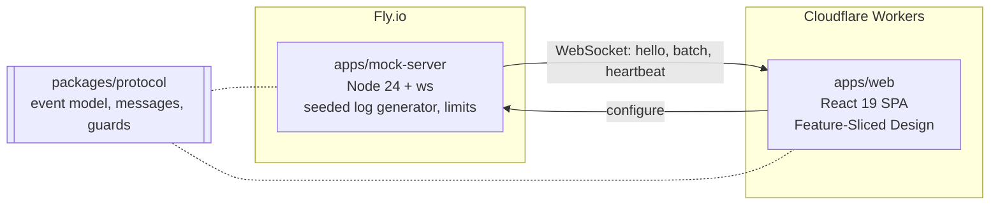

# Log Stream Viewer

> Real-time log stream viewer for the browser: thousands of events per second over WebSocket, a virtualized table for 100K+ rows, search and filters in a Web Worker, and event-rate charts.

[](https://github.com/dr1m11/log-stream-viewer/actions/workflows/ci.yml)
[](https://github.com/dr1m11/log-stream-viewer/actions/workflows/deploy.yml)
[](LICENSE)

**[Live demo](https://log-stream-viewer.marat-gabdrashitov17.workers.dev)** · **[Roadmap](docs/roadmap.md)** · **[Product spec](docs/product-spec.md)** · **[Wire protocol](docs/protocol.md)** · **[Architecture decisions](docs/adr/README.md)**

> 🚧 Work in progress. Stage B1 (foundation) is done: the mock server streams live logs from Fly.io to the web app on Cloudflare Workers. The table, search and charts come with stages B2–B5. Progress is tracked in [milestones](https://github.com/dr1m11/log-stream-viewer/milestones).

## Features

Available now:

- A Node mock server that generates realistic logs from several services, deterministically from a seed, in three scenarios (`steady`, `error-burst`, `traffic-spike`) at 10 to 5,000 events per second in the demo
- A versioned wire protocol (JSON batches over WebSocket) shared by server and client as one package, with golden fixtures and a compatibility policy
- The web app connects on open and shows the connection status, events received and per second, missed and dropped events, and a virtualized table of the received events that follows the newest one (keyboard navigable, "Jump to latest" after scrolling up); stream settings come from the URL (`/?rate=500&scenario=error-burst&seed=42`)
- Pause and resume the table (button or <kbd>P</kbd>): the view holds still while events keep arriving in the buffer, a badge counts the new ones, resume shows all of them and follows the tail again, and a warning says when the full buffer starts evicting events of the paused view
- Server limits that keep a public demo cheap: an Origin allowlist, connection caps per IP and in total, a global event budget, 30-minute sessions, and a machine that suspends when idle
- Light and dark themes without a flash, a strict Content Security Policy, and a preview deployment for every pull request from a branch of this repository

Planned:

- Ring buffer with a hard capacity, batched rendering once per animation frame, a virtualized table for 100K+ rows, follow tail and pause (B2)
- Search, filters and regex in a Web Worker with cancellation, filter state in the URL (B3)
- Reconnection with backoff and jitter, a lag indicator, an SSE mode (B4)
- Event-rate charts by level with uPlot, linked to the table (B5)
- Published FPS, INP and memory measurements for 10K / 100K / 1M events (B6)

## Tech stack

React 19 · TypeScript (strict) · Vite · Tailwind CSS · Node 24 + `ws` · Vitest · Testing Library · Playwright · Lighthouse CI · pnpm workspaces · Cloudflare Workers · Fly.io

## Architecture



```
apps/web/              React SPA, Feature-Sliced Design (checked by Steiger)
apps/mock-server/      Node 24 + ws, runs its TypeScript sources directly (no build step)
packages/protocol/     log event model and wire messages: the only contract between server and client
packages/core/         framework-free stream engine: columnar ring buffer, column batches, stream stats
docs/adr/              architecture decision records
```

- **One contract.** The server and the web app never import each other; they share only `@lsv/protocol`, which has no dependencies and no React, DOM or Node APIs. Its guards check the envelope and scalar fields only, because parsing is on the hot path. See [ADR 0001](docs/adr/0001-monorepo-layout.md) and [ADR 0004](docs/adr/0004-log-event-model-and-wire-protocol-v1.md).
- **A reproducible stream.** The same seed and scenario produce the same events, so tests and benchmarks run against a known stream; the generator is tested with a fake clock. See [ADR 0005](docs/adr/0005-mock-server.md).
- **Performance rules.** No React state update per event: events go into a bounded buffer outside React and the UI reads a snapshot once per animation frame; filtering and search run off the main thread; every claimed improvement comes with a measurement.
- **Feature-Sliced Design** in the web app, with layer boundaries enforced by [Steiger](https://github.com/feature-sliced/steiger) in CI.
- **Hosting.** The mock server runs on Fly.io (one machine that suspends when idle), the web app on Cloudflare Workers static assets; the server deploys before the client, so a client never ships ahead of the protocol it speaks. See [ADR 0003](docs/adr/0003-hosting.md).

## Getting started

Requires Node.js 24.15+ and pnpm 10 (the version in `packageManager`, enabled through Corepack).

```bash
pnpm install
pnpm dev          # mock server on :8787 and the web app on http://localhost:5173
```

Stream settings go in the page URL, for example http://localhost:5173/?rate=1000&scenario=error-burst&seed=42. Environment variables are listed in [`.env.example`](.env.example).

| Script                     | Description                                                               |
| -------------------------- | ------------------------------------------------------------------------- |
| `pnpm dev`                 | Mock server (:8787) and Vite dev server (:5173)                           |
| `pnpm build:local`         | Production build of the web app against the local mock server             |
| `pnpm preview`             | Serve the build on :4173 with its CSP headers                             |
| `pnpm verify`              | Format check, lint, Steiger, typecheck, unit tests, hook tests, build     |
| `pnpm verify:full`         | `verify` plus Playwright e2e                                              |
| `pnpm test`                | Unit and integration tests (`protocol`, `mock-server` and `web` projects) |
| `pnpm test:coverage`       | Unit tests with coverage thresholds                                       |
| `pnpm test:e2e`            | Playwright against `vite preview` and the mock server (run `build:local`) |
| `pnpm bench`               | Vitest benchmarks, such as protocol parsing                               |
| `pnpm serve:demo` / `lhci` | Preview and mock server together / Lighthouse CI against them             |

## Quality gates

Every pull request runs:

| Check            | What it enforces                                                                              |
| ---------------- | --------------------------------------------------------------------------------------------- |
| Lint & typecheck | Prettier, ESLint with type-aware rules, Steiger, TypeScript strict (no `any`), hook tests     |
| Unit tests       | Vitest + Testing Library; ≥ 90% coverage on `packages/protocol`, ≥ 80% on the mock server     |
| E2E              | Playwright against the production build and the mock server, with axe and a CSP/console guard |
| Lighthouse CI    | Accessibility must score 100; performance, best practices and the script budget are tracked   |
| Server image     | The Docker image builds, passes `/healthz` and a WebSocket smoke test                         |
| PR title         | Conventional Commits (the squash-merge commit message), no AI attribution                     |
| Preview          | A preview URL commented on the PR (not for forks and Renovate)                                |

`main` is protected: changes land only through squash-merged pull requests with green checks. Dependencies are kept current by [Renovate](.github/renovate.json5): grouped weekly updates, pinned action digests, and automerge for minor and patch updates of dev tooling.

## Architecture decisions

| ADR                                                           | Decision                                                                    |
| ------------------------------------------------------------- | --------------------------------------------------------------------------- |
| [0001](docs/adr/0001-monorepo-layout.md)                      | Monorepo layout                                                             |
| [0002](docs/adr/0002-toolchain-baseline.md)                   | Toolchain baseline                                                          |
| [0003](docs/adr/0003-hosting.md)                              | Hosting: mock server on Fly.io, web app on Cloudflare Workers               |
| [0004](docs/adr/0004-log-event-model-and-wire-protocol-v1.md) | Log event model and wire protocol v1                                        |
| [0005](docs/adr/0005-mock-server.md)                          | Mock server: Node 24 native TypeScript, ws, deterministic generator, limits |

## Roadmap

| Stage | Outcome                                               | Status  |
| ----- | ----------------------------------------------------- | ------- |
| B1    | Monorepo, CI, mock server, deploy                     | Done    |
| B2    | WebSocket, buffer, virtualization, follow tail, pause | Next    |
| B3    | Web Worker search, regex, URL state                   | Planned |
| B4    | Reconnection, lag indicator, SSE mode                 | Planned |
| B5    | uPlot charts, chart-to-table linking                  | Planned |
| B6    | Performance table, tests, README, ADRs                | Planned |

Details in [docs/roadmap.md](docs/roadmap.md).

## Performance

FPS while scrolling, INP and memory for 10K / 100K / 1M events will be published here with stage B6.

## Working on this repository

Commits follow [Conventional Commits](https://www.conventionalcommits.org/) and are checked by commitlint; every change goes through a pull request. The repository also ships a [Claude Code](https://code.claude.com) setup — project rules in `CLAUDE.md` and `.claude/` (path-scoped rules, skills, review agents, guard and formatting hooks) — that encodes the same conventions for AI-assisted work.

## License

[MIT](LICENSE) © Marat Gabdrashitov
