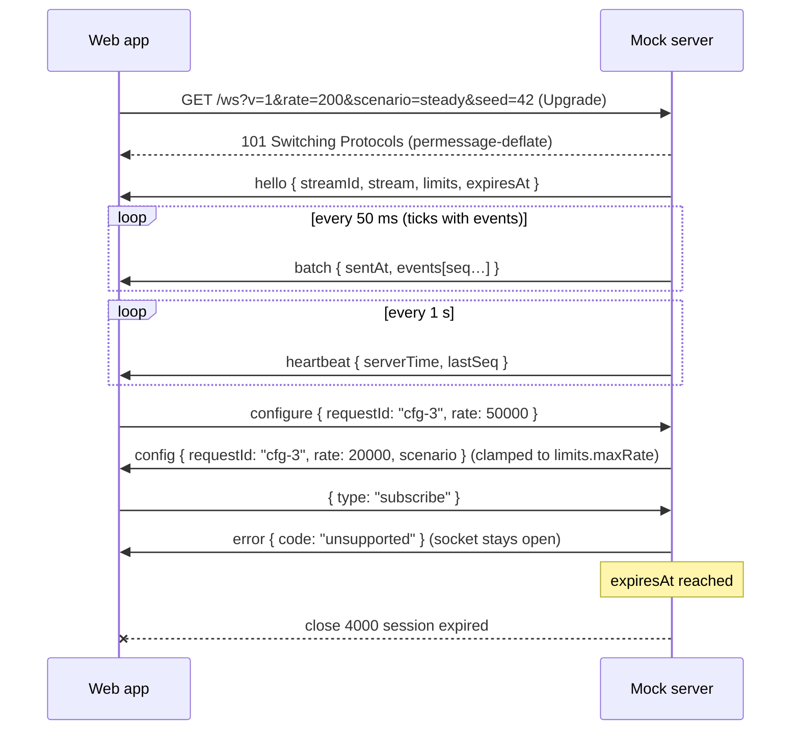

# Wire protocol

The contract between the mock server (`apps/mock-server`) and the web app (`apps/web`). Both sides import it from [`@lsv/protocol`](../packages/protocol/src/index.ts); this page explains it. Decision record: [ADR-0004](./adr/0004-log-event-model-and-wire-protocol-v1.md).

Current version: **1** (`PROTOCOL_VERSION`).

## Overview

- One WebSocket per viewer at `/ws`, with permessage-deflate. Every message is a UTF-8 JSON **text** frame: an object with a string `type`. Binary frames are not part of v1; a peer treats one like a malformed message.
- The server generates events and flushes them as one `batch` every `BATCH_INTERVAL_MS` (50 ms); ticks without events may be skipped. A `heartbeat` follows every `HEARTBEAT_INTERVAL_MS` (1 s), with or without events.
- Every event carries a `seq` that grows by one within its stream (`hello.streamId`), starting at 1. **A gap in `seq` is the only signal of lost events**; `batch.dropped` is informational.
- Times are epoch milliseconds of the server clock (`serverTime`, `sentAt`, `ts`, `expiresAt`), from 0 to 8.64e15 (the range of a `Date`). With the client's receive time they give an estimate of lag and clock offset (used from B4).
- Parsing: `parseServerMessage(raw)` / `parseClientMessage(raw)` return a `Result` and never throw. They check the envelope and every scalar field — including each event of a batch and that `seq` strictly increases within it — but not the contents of `payload`. Server messages keep fields this version does not know; a client message comes from an untrusted peer, so its parser returns a fresh object with the known fields only.

## Connection

```
wss://log-stream-viewer-mock.fly.dev/ws?v=1&rate=200&scenario=steady&seed=42
ws://localhost:8787/ws?v=1                      (local default, VITE_STREAM_URL)
```

Build the URL with `buildConnectionUrl(endpoint, params)`; the server reads it with `parseConnectionQuery(query)`.

| Param      | Value                                        | Default                       | Notes                                                                                                                                                                                                      |
| ---------- | -------------------------------------------- | ----------------------------- | ---------------------------------------------------------------------------------------------------------------------------------------------------------------------------------------------------------- |
| `v`        | protocol version, positive integer           | — (required)                  | Missing, malformed or unsupported → upgrade, then close **4001**.                                                                                                                                          |
| `rate`     | events per second, non-negative integer      | `DEFAULT_RATE` (200)          | Clamped to `[limits.minRate, limits.maxRate]`. The floor is `MIN_RATE` (10); the ceiling is the mock server's `MAX_RATE` environment variable (not a package export), sent to clients as `limits.maxRate`. |
| `scenario` | `steady` \| `error-burst` \| `traffic-spike` | `steady` (`DEFAULT_SCENARIO`) |                                                                                                                                                                                                            |
| `seed`     | integer `0…MAX_SEED` (unsigned 32-bit)       | chosen by the server          | The same seed and scenario reproduce the stream.                                                                                                                                                           |
| `resume`   | `streamId` to continue                       | —                             | **Reserved for B4** (see below). Only together with `after`.                                                                                                                                               |
| `after`    | last `seq` the client has                    | —                             | **Reserved for B4** (see below). Only together with `resume`.                                                                                                                                              |

Parsing is tolerant: unknown parameters are skipped, the first occurrence of a repeated one wins, and an invalid optional parameter is ignored (reported in `ignored`, its value cut to `MAX_ISSUE_VALUE_LENGTH` characters so it fits a close reason), so the server falls back to its default. The effective values always come back in `hello.stream`.

Before the upgrade the server rejects only requests from a foreign `Origin` (HTTP 403). Everything else is answered after the upgrade with a close code, because a browser never sees the HTTP status of a failed handshake — it only gets a bare 1006.

### Reserved: resume (B4)

`resume=<streamId>&after=<seq>` lets a reconnecting client continue its stream. The intent for B4:

- If the server still has the stream and `after` is not ahead of it, it answers `hello` with `resumed: true` and the same `streamId`, and continues with `seq` `after + 1`. Whatever it can no longer replay shows up as a `seq` gap.
- If the stream is unknown or expired, or `after` is ahead of the server's last `seq`, the server starts a new stream: `resumed: false` and a new `streamId`. The client must compare `hello.streamId` with the one it asked for and, if they differ, treat the stream as new (reset its `seq` tracking).
- A resume does not restart the session: `expiresAt` keeps the original expiry, so reconnecting cannot extend a session past `limits.sessionMaxMs`.
- Over SSE (the alternative transport in B4) the event `id` is the `seq`, so the browser's automatic `Last-Event-ID` header carries the last `seq`; `resume` stays in the URL. SSE has no client → server channel, so `configure` needs a separate endpoint, decided in B4.

A B1 server parses both parameters, ignores them and always starts a new stream (`resumed: false`).

## Messages

Server → client:

| Type        | Fields                                                                                                                                              | When                                                                                                                                                     |
| ----------- | --------------------------------------------------------------------------------------------------------------------------------------------------- | -------------------------------------------------------------------------------------------------------------------------------------------------------- |
| `hello`     | `protocolVersion`, `streamId`, `resumed`, `serverTime`, `stream { rate, scenario, seed }`, `limits { minRate, maxRate, sessionMaxMs }`, `expiresAt` | First message after the upgrade.                                                                                                                         |
| `batch`     | `sentAt`, `events: LogEvent[]` (strictly ascending `seq`), `dropped?`                                                                               | Every 50 ms tick that has events. `dropped` counts events skipped since the previous batch (backpressure).                                               |
| `heartbeat` | `serverTime`, `lastSeq`                                                                                                                             | Every second. `lastSeq` is the highest `seq` assigned so far, sent or dropped; 0 before the first event.                                                 |
| `config`    | `requestId?`, `rate`, `scenario`                                                                                                                    | After `configure` (echoes its `requestId`), or when the server changes the settings itself (no `requestId`). Values are the effective, clamped settings. |
| `error`     | `code` (non-empty string), `message`                                                                                                                | A client message was malformed (`bad-message`) or of an unknown type (`unsupported`). The socket stays open.                                             |

`error.code` is open: v1 servers send the codes in `KNOWN_ERROR_CODES` (`bad-message`, `unsupported`), and newer servers may add others. Clients check `isKnownErrorCode(code)` and treat any other code as a generic error.

Client → server:

| Type        | Fields                             | When                                                                                                     |
| ----------- | ---------------------------------- | -------------------------------------------------------------------------------------------------------- |
| `configure` | `requestId?`, `rate?`, `scenario?` | The user changes the stream settings. Omitted fields stay as they are; the server answers with `config`. |

`LogEvent`:

| Field     | Type                       | Notes                                                                   |
| --------- | -------------------------- | ----------------------------------------------------------------------- |
| `seq`     | positive integer           | Position in the stream; gaps mean lost events.                          |
| `ts`      | epoch ms                   | Server clock.                                                           |
| `level`   | `trace` … `fatal`          | `LOG_LEVELS`, ordered by severity. Closed set (see Compatibility).      |
| `service` | non-empty string           | `api-gateway`, `auth`, `orders`, `payments`, `search`, `notifications`. |
| `host`    | non-empty string           | Instance, e.g. `payments-7f9c-2`.                                       |
| `message` | string                     | May be empty.                                                           |
| `traceId` | non-empty string, optional | Correlates events of one request across services.                       |
| `payload` | JSON object, optional      | HTTP details, latency, ids, error stack… Not validated deeply.          |

Client frames are limited to `MAX_CLIENT_MESSAGE_BYTES` (4096); a bigger one closes the socket with 1009. Their rate is limited per connection to `MAX_CLIENT_MESSAGES_PER_SECOND` (20) with bursts of `CLIENT_MESSAGE_BURST` (40), WebSocket pings included; a client that sends faster is closed with 1008. While the server's send buffer for a connection is backed up (the client is not reading), it still applies a valid `configure` but holds back the answer: once the buffer drains it sends one `config` with the current settings, echoing the `requestId` of the latest `configure`. Malformed, binary or unknown frames get no `error` during that time.

### Golden fixtures

[`packages/protocol/fixtures/v1/`](../packages/protocol/fixtures/v1/) holds an example of every message, variants (resumed `hello`, `batch` with `dropped` or with unknown fields, `error` with a code this version does not know) and deliberately broken `invalid-*.json` files. Server and client tests both use them; the package exports them, so other workspace packages resolve a file without relative paths:

```ts
const url = import.meta.resolve('@lsv/protocol/fixtures/v1/hello.json');
const raw = readFileSync(new URL(url), 'utf8');
```

## Close codes

| Code | Name (`CLOSE_CODES`) | Sent when                                                | Client reaction                                                                             |
| ---- | -------------------- | -------------------------------------------------------- | ------------------------------------------------------------------------------------------- |
| 1000 | `normal`             | A peer closes on purpose.                                | —                                                                                           |
| 1001 | `goingAway`          | The server shuts down or redeploys.                      | Reconnect with backoff.                                                                     |
| 1008 | `policyViolation`    | The client sent more messages than the server's limit.   | Reconnect with backoff (and fix the client).                                                |
| 1009 | `messageTooBig`      | A client frame exceeded `MAX_CLIENT_MESSAGE_BYTES`.      | Reconnect with backoff (and fix the client).                                                |
| 4000 | `sessionExpired`     | The session reached `limits.sessionMaxMs` (`expiresAt`). | **Terminal**: no automatic reconnect; offer the user to start again.                        |
| 4001 | `unsupportedVersion` | The server does not speak the requested `v`.             | **Terminal**: ask the user to reload the page to get a matching client.                     |
| 4029 | `busy`               | Connection limits reached, in total or per IP.           | Retry after the delay in the reason (`busy; retry-after=<seconds>`, `retryAfterSeconds()`). |

`isTerminalCloseCode(code)` is true for 4000 and 4001 only; every other code, including unknown ones and 1006, allows a reconnect with backoff. The `retry-after` delay is capped at `MAX_RETRY_AFTER_SECONDS` (3600) on both sides.

## Sequence



Rejections follow the same shape: the upgrade succeeds and the server closes right away with 4001 (unsupported `v`) or 4029 (busy).

## Compatibility and versioning

Within a protocol version only **additive** changes are allowed:

- new optional fields — server messages keep fields the client does not know; the server's parser drops unknown client fields;
- new message types — the client ignores unknown types; the server answers an unknown client type with `error` / `unsupported` and keeps the socket open;
- new `error` codes — `error.code` is any non-empty string, and clients treat codes they do not know as a generic error;
- new close codes in 4000–4999 — an old client treats an unknown code as non-terminal and reconnects with backoff.

`level` and `scenario` are **closed** sets: a parser rejects a value it does not know.

- A new **log level** is always breaking — every client receives every level.
- A new **scenario** is additive only while it reaches nobody who did not ask for it. A new client that connects with `?scenario=<new>` to an old server gets the default (an ignored parameter, visible in `hello.stream`); a new client that sends `configure` with it gets `error` / `bad-message` and the settings stay unchanged. A server that puts a scenario into `hello` or `config` on its own initiative (for example a new default) breaks old clients, so that needs a new version.

How a client handles frames it cannot use:

- `unknown-type` — ignore the frame.
- `invalid-json` / `invalid-message` — drop the frame, count it (a protocol-error counter for diagnostics), keep the socket open and never crash; lost events show up as a `seq` gap.
- `hello.protocolVersion !== PROTOCOL_VERSION` — close the socket and treat it as terminal, like 4001: ask the user to reload.

**Breaking** changes — removing or renaming a field, changing a type or meaning, making an optional field required, a new log level, a new scenario sent without being asked for — bump `PROTOCOL_VERSION`, add `fixtures/v<N>/` and a changelog line below, and need an ADR. Prefer an additive design when one exists.

Deploy order: **server first**. PR previews and tabs that are still open use the production server, so a new server keeps serving the previous version until the old clients are gone; once it drops a version, it closes such connections with 4001 and the page asks for a reload. The `/protocol-change` skill walks through a change.

## Changelog

- v1 — 2026-10-14 — initial
- v1 — 2026-10-15 — client message rate limit, frames and pings (`MAX_CLIENT_MESSAGES_PER_SECOND`, `CLIENT_MESSAGE_BURST`), and close code 1008 `policyViolation` — additive (unknown codes already mean "reconnect with backoff")
